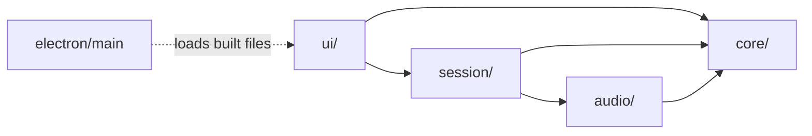
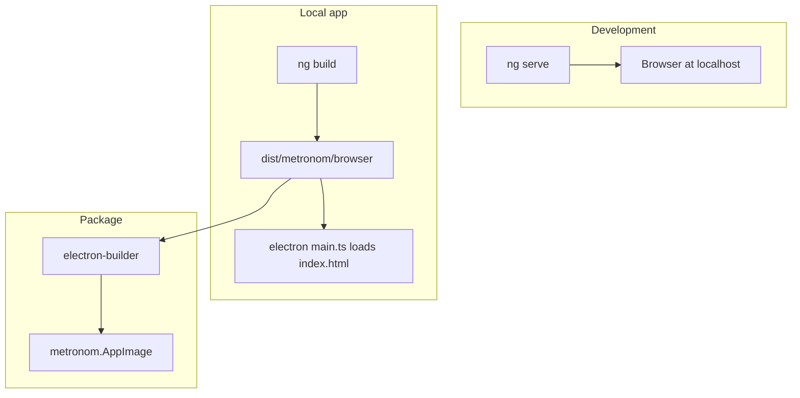

# Architecture Spine: metronom

## Design Paradigm

**Functional core, imperative shell.** The rules of the metronome (ramp and validation) are pure TypeScript with no framework, DOM, or audio imports. Everything with side effects (audio, time, UI, window) is a thin shell around that core.

| Layer | Directory | May import |
| --- | --- | --- |
| Core (pure) | `src/app/core/` | nothing outside `core/` |
| Audio engine | `src/app/audio/` | `core/` |
| Session | `src/app/session/` | `core/`, `audio/` |
| UI | `src/app/ui/` | `session/`, `core/` (types and validation only) |
| Electron shell | `electron/` | Electron and Node only, never `src/` |



## Invariants & Rules

### AD-1: The ramp is one pure function

- **Binds:** FR-5, FR-8
- **Prevents:** the scheduler, the BPM display, and the countdown each computing tempo, Hold, or bars-to-next differently.
- **Rule:** `core/ramp.ts` exports `rampAt(settings, barIndex)` returning `{ tempo, hold, barsToNext }`. With `k = floor(barIndex / interval)` and `kMax = floor((ceiling − start) / step)`: `tempo = start + min(k, kMax) · step`, `hold = k ≥ kMax`, and `barsToNext = interval − (barIndex mod interval)` when not in Hold. Nothing else computes these values.

### AD-2: Validation is one pure function

- **Binds:** FR-1, FR-2
- **Prevents:** the form, the Start button, and the spacebar or Enter handlers disagreeing on whether Settings are startable.
- **Rule:** `core/settings.ts` exports `validate(settings)` returning `{ ok: true } | { ok: false, message }`, with the messages worded as in EXPERIENCE.md. Every start path (button, spacebar, Enter) calls `SessionService.start()`, which refuses invalid Settings using this function.

### AD-3: The AudioContext clock is the only time source

- **Binds:** FR-5, FR-6, FR-7
- **Prevents:** drift between sound and display, and stutter at an Increase caused by a second timer.
- **Rule:** `audio/scheduler.ts` runs a look-ahead loop (a tick about every 25 ms that schedules clicks up to about 100 ms ahead) against `AudioContext.currentTime`. Beat times come from accumulating `60 / tempo` seconds. At each Bar start, the scheduler takes the tempo from `rampAt`. No `setInterval`, RxJS timer, or CSS animation drives Beats anywhere in the app.

### AD-4: The display follows the audio schedule

- **Binds:** FR-7, FR-8
- **Prevents:** the highlight running ahead of or behind the click, and components deriving Beat state on their own.
- **Rule:** for every scheduled click, the scheduler enqueues a `BeatEvent { audioTime, beat, barIndex, tempo, hold, barsToNext }`. A single `requestAnimationFrame` loop in `SessionService` publishes the latest event whose `audioTime ≤ currentTime`. UI components only render the published event.

### AD-5: SessionService is the single owner of session state

- **Binds:** FR-3, FR-4
- **Prevents:** two components starting audio, or the Settings changing during a Session.
- **Rule:** `session/session.service.ts` (root-provided) holds `settings`, `status ('idle' | 'playing')` and `current: BeatEvent | null` as Angular signals. Only `updateSettings()` (refused while playing), `start()` and `stop()` mutate them. Components read signals and call those three methods. `stop()` tears down the scheduler and leaves the Settings intact; `start()` always begins at bar 0.

### AD-6: One keyboard handler

- **Binds:** FR-4
- **Prevents:** Space toggling twice (window handler plus focused button) or typing into a field.
- **Rule:** only the root component listens for keys, on `window:keydown`. Space toggles start/stop and always calls `preventDefault`. Enter starts the Session when idle, and Escape stops it when playing. No other component binds Space, Enter, or Escape.

### AD-7: Electron is a sealed, thin shell

- **Binds:** all
- **Prevents:** renderer code depending on Node or Electron APIs, which would break `ng serve` development and widen the attack surface.
- **Rule:** `electron/main.ts` creates one `BrowserWindow` with `contextIsolation: true`, `nodeIntegration: false` and `sandbox: true`, and loads the built `index.html` from disk. There is no preload script and no IPC. The renderer must run unchanged in a normal browser.

### AD-8: Fully offline

- **Binds:** all
- **Prevents:** a dependency or font silently fetching from the network.
- **Rule:** no runtime network requests. `index.html` sets the CSP `default-src 'self'`, with `style-src 'self' 'unsafe-inline'` only if Angular needs it. No web fonts or CDN assets. The click is synthesised with `OscillatorNode` + `GainNode`, with no audio files.

## Consistency Conventions

| Concern | Convention |
| --- | --- |
| Naming | Glossary terms from the PRD in code: `startBpm`, `ceilingBpm`, `step`, `interval`, `hold`, `barIndex`, `beat` (1–4). Files are kebab-case, as is Angular's default. |
| Components | Standalone, `OnPush`, signal inputs. No NgModules, and no Router (one surface). |
| Change detection | Zoneless (the Angular default). State reaches templates only through signals. |
| Styling | Tokens from DESIGN.md as CSS custom properties in `src/styles.css` (`--color-accent`, …). Components use the variables and never hard-code hex values. |
| Audio lifecycle | One `AudioContext`, created lazily on the first `start()` and resumed on each start. If it fails, `start()` stays idle and the UI shows "No audio output available". |
| Paths | `<base href="./">`, so the build loads from `file://` inside Electron. |
| Tests | Vitest. `core/` has full table tests, including the FR-5 examples. `session/` is tested with a fake clock. |

## Stack

| Name | Version |
| --- | --- |
| Node.js | 24 LTS (≥ 24.15) |
| Angular (core, CLI, build) | 22.2.x |
| TypeScript | 6.0.x (Angular 22 requires ≥ 6.0 < 6.1) |
| Electron | 44.8.x |
| electron-builder | 26.15.x |
| Vitest | 5.0.x |

## Structural Seed

```text
metronom/
  src/
    index.html            # CSP, base href ./
    styles.css            # DESIGN.md tokens as CSS variables
    app/
      app.ts              # root component: layout + window keyboard handler (AD-6)
      core/               # ramp.ts, settings.ts (+ .spec.ts), pure
      audio/              # scheduler.ts, click.ts
      session/            # session.service.ts, beat-event.ts
      ui/                 # settings-form/, settings-strip/, beat-display/
  electron/
    main.ts               # BrowserWindow, loads dist (AD-7)
  electron-builder.yml    # linux: AppImage
```



## Capability → Architecture Map

| Capability | Lives in | Governed by |
| --- | --- | --- |
| FR-1 to FR-3 Settings | `ui/settings-form`, `core/settings.ts`, `SessionService` | AD-2, AD-5 |
| FR-4 Start/Stop | root component, `SessionService` | AD-5, AD-6 |
| FR-5 Ramp | `core/ramp.ts`, `audio/scheduler.ts` | AD-1, AD-3 |
| FR-6 Click | `audio/click.ts` | AD-3, AD-8 |
| FR-7, FR-8 Beat display | `ui/beat-display`, `ui/settings-strip` | AD-4 |

## Deferred

- **Packaging targets other than AppImage** (deb, rpm, Flatpak): not needed for one local user.
- **App icon and `.desktop` launcher integration**: cosmetic, can come at the end.
- **CI, auto-update, code signing**: a personal local app has no release pipeline.
- **End-to-end tests**: the risk lives in the pure core and the scheduler, which unit tests cover.
- **Window size and position memory**: the PRD rules out persistence.
